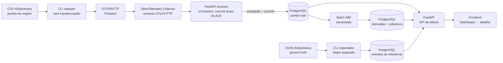

# Fluxo do replay histórico na V1 local

**Estado:** fluxo executado e verificado localmente. No Compose completo, o replayer envia OTLP via Collector; no modo host, é possível enviar diretamente à API FastAPI. Ground truth e amostras métricas seguem caminhos separados.

No Compose, o Collector encaminha as requisições de forma síncrona, sem compressão, fila ou batch processor. O receiver responde sucesso OTLP somente após o commit da transação; se o commit falhar, não há aceitação. O batch consulta apenas dados raw persistidos. Uma falha de CPU injetada do ground truth não é detector nem resultado de causalidade. Após reinício, o volume PostgreSQL mantém os dados e a UI consulta os mesmos IDs de replay e transformação.
