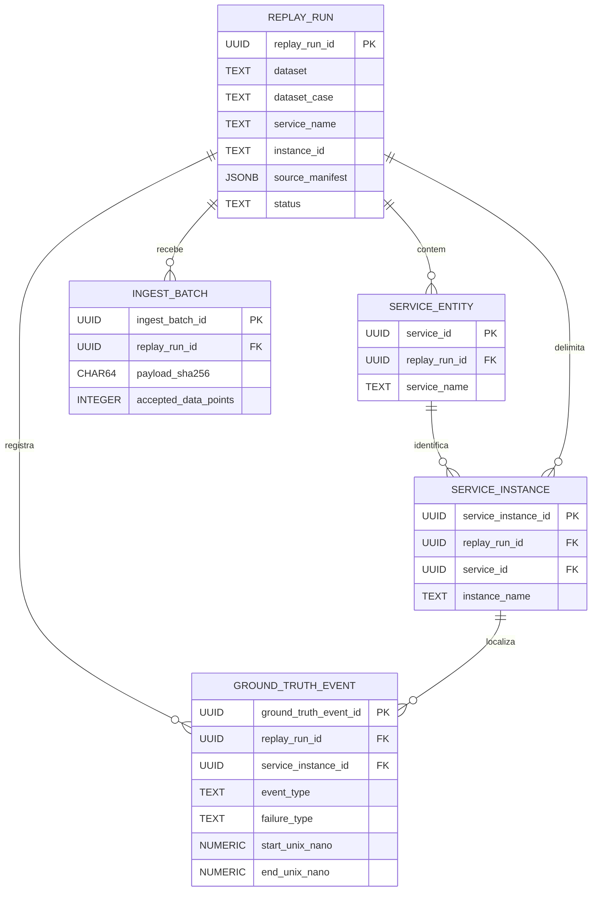
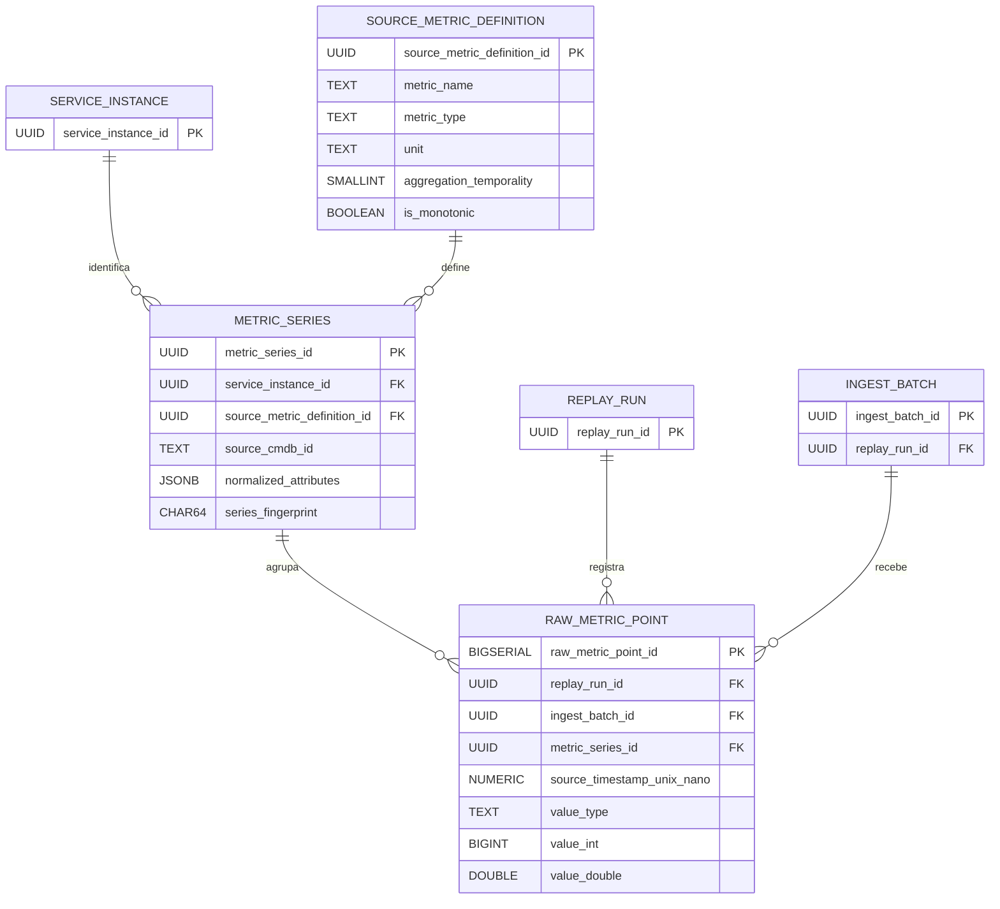
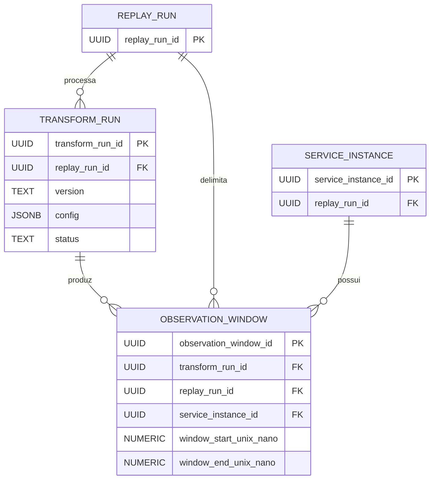
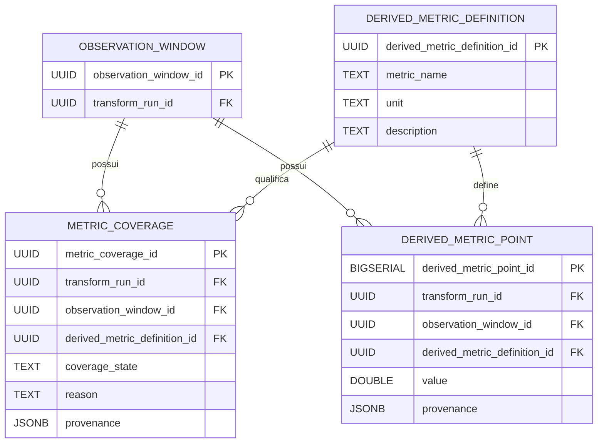
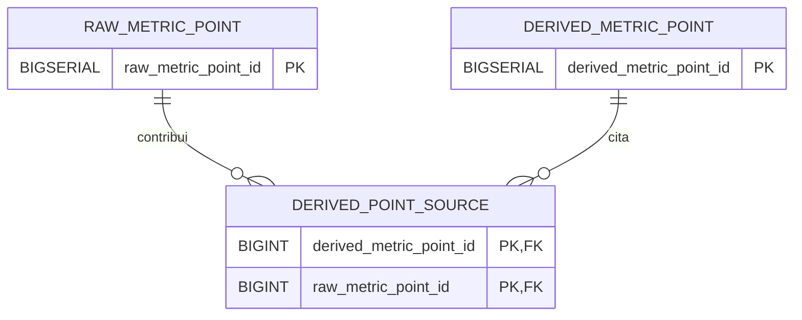

# MER físico da V1

**Fonte:** [migration 001_init.sql](../../system/backend/aim/migrations/001_init.sql). Este modelo documenta a persistência implementada na V1. O modelo conceitual da solução orientada ao uso cotidiano permanece como etapa de evolução.

O [arquivo editável no draw.io](mer-v1.drawio) contém **14 tabelas, 104 colunas e as 24 constraints de FK** da migration. A leitura foi dividida em cinco abas por assunto; cada tabela aparece completa em sua aba principal. Tabelas repetidas nas demais abas mostram apenas as chaves necessárias e indicam onde consultar a definição completa. Essas referências são projeções da mesma tabela, não novas entidades. O layout usa cartões compactos amarelos, no padrão relacional da referência visual, e ligações tracejadas com cardinalidade nos extremos.

| Aba | Tabelas completas |
| --- | --- |
| 1. Replay e identidade | `replay_run`, `service_entity`, `service_instance`, `ingest_batch`, `ground_truth_event` |
| 2. Telemetria bruta | `source_metric_definition`, `metric_series`, `raw_metric_point` |
| 3. Transformação e janelas | `transform_run`, `observation_window` |
| 4. Métricas derivadas | `derived_metric_definition`, `metric_coverage`, `derived_metric_point` |
| 5. Proveniência | `derived_point_source` |

No draw.io, cada tabela separa **PK/FK**, **nome da coluna** e **tipo SQL**. `?` indica coluna que aceita `NULL`; `UQ` identifica uma restrição de unicidade. As ligações tracejadas partem da chave referenciada e chegam à linha da FK: **um pai por filho; zero ou muitos filhos por pai**. Todas as FKs da migration são obrigatórias no filho. A migration não exige um mínimo de filhos.

Uma ligação representa cada par de tabelas. Quando existem FKs simples e compostas para o mesmo pai, todas estão listadas no rodapé e no tooltip da ligação, preservando os 24 vínculos SQL em 21 associações visuais. Para uma FK composta, a ligação encontra a primeira coluna; o rodapé informa a composição completa. `CHECK`, `DEFAULT` e índices permanecem descritos na migration.

Os diagramas Mermaid abaixo são visões resumidas das mesmas relações, com chaves e atributos representativos. As definições completas dos 104 atributos estão no draw.io.

## 1. Replay e identidade



`service_instance` referencia `service_entity` pela FK composta `(service_id, replay_run_id)`. `ground_truth_event` possui FK simples para a instância e também FK composta `(service_instance_id, replay_run_id)`, além do vínculo direto ao replay. Eventos representam falhas injetadas de referência; não são inferências causais do AIM.

## 2. Telemetria bruta



A FK do ponto bruto para o lote é composta: `(ingest_batch_id, replay_run_id)`. `value_int` e `value_double` aceitam `NULL` individualmente; o `CHECK` exige exatamente o campo coerente com `value_type`. A identidade da definição de origem inclui nome, tipo, unidade, temporalidade e monotonicidade.

## 3. Transformação e janelas



As FKs compostas `(transform_run_id, replay_run_id)` e `(service_instance_id, replay_run_id)` mantêm transformação e instância no replay da janela. A migration também contém as FKs simples correspondentes, preservadas no rodapé da aba.

## 4. Métricas derivadas



Em cobertura e ponto derivado, a FK para a janela é `(observation_window_id, transform_run_id)`. **Não existe uma FK direta dessas tabelas para `transform_run`**; o vínculo à transformação ocorre pela janela. A unicidade de `(transform_run_id, observation_window_id, derived_metric_definition_id)` limita cada tabela a um registro por combinação, mas não exige a existência de cobertura ou ponto para toda janela. Cobertura e valor são tabelas distintas; não existe FK entre elas.

## 5. Proveniência



`derived_point_source` resolve a associação **N:M** com PK composta `(derived_metric_point_id, raw_metric_point_id)`. A migration permite que um ponto bruto ou derivado não tenha associações. Excluir um ponto derivado remove suas associações (`CASCADE`); excluir um ponto bruto referenciado é restringido (`RESTRICT`).

## Reprodução e verificação

O XML foi gerado diretamente da migration com:

```powershell
python scripts/diagrams/generate_mer_v1.py
```

O [gerador](../../scripts/diagrams/generate_mer_v1.py) verifica a cobertura das 14 tabelas e das 24 FKs, a validade do XML, a unicidade dos IDs em cada aba, os terminais das ligações e a geometria das arestas. Ele apenas lê a migration e escreve o `.drawio`; não aplica migrations nem se conecta ao banco.

As relações e as 14 definições de tabela são geradas diretamente da migration. O gerador valida os IDs, as células-pai, os terminais das ligações e a cobertura das 24 FKs. As imagens PNG/SVG são prévias exportadas e precisam ser regeneradas ao editar o XML; o arquivo `.drawio` é a fonte editável. Essa conferência estrutural não substitui validação de execução do backend ou do banco.
